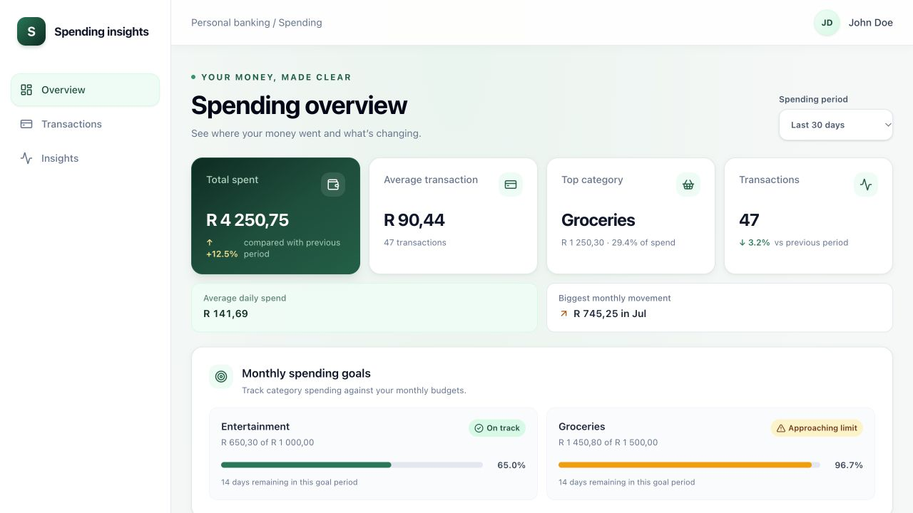

# Customer Spending Insights Dashboard

**Live demo:** [andanimagodi.github.io/customer-spending-insights-dashboard](https://andanimagodi.github.io/customer-spending-insights-dashboard/)

Responsive React and TypeScript dashboard for exploring customer spending insights. It displays illustrative sample data in South African rand; it does not connect to a banking service or make financial decisions.

## Screenshots



## Run locally

Requirements: Node.js 22 or newer and npm.

```sh
npm ci
npm run dev
```

The local config at `public/config.json` enables the MSW demo API by default. To connect to a real API during local development, set `apiUrl` to its base URL and `mockApi` to `false` in that file. Vite serves the file at runtime, so no rebuild is needed after changing it.

The dashboard is available at http://localhost:5173 after starting Vite. The same production image can be previewed locally on port 8080 with Docker.

GitHub Pages deploys from `main` only after the CI workflow passes linting, tests, build, dependency audit, and Docker smoke checks.

## Docker

```sh
docker build -t customer-spending-insights-dashboard .
docker run --rm -p 8080:8080 customer-spending-insights-dashboard
```

Open http://localhost:8080. The container runs Nginx as an unprivileged user on port 8080. It uses the mock API when no API URL is supplied. To point the same image at a real API, set the runtime environment variable:

```sh
docker run --rm -p 8080:8080 \
  -e VITE_API_URL=https://api.example.com \
  customer-spending-insights-dashboard
```

The container entrypoint writes `config.json` when the container starts, so the API URL is not baked into the image. Use an API origin allowed by your API's CORS policy.

## Quality checks

```sh
npm run lint
npm run test
npm run build
npm audit --audit-level=high
```

The GitHub Actions workflow runs lint, tests, build, dependency audit, Docker build, and a container HTTP smoke test. It publishes to GitHub Pages only after every quality check succeeds.

## Project structure

```text
src/
├── features/spending/
│   ├── api/           # Zod API schemas and typed fetch client
│   ├── components/    # Dashboard shell, cards, charts, and transaction UI
│   ├── mocks/         # MSW handlers, fixtures, browser worker, and test server
│   ├── pages/         # Dashboard page and query orchestration
│   └── types.ts       # Domain types derived from the API schemas
├── lib/format.ts      # Shared locale-aware formatters
├── appConfig.ts       # Runtime configuration loader and validation
└── index.css          # Global styles and design tokens
```

## Data and API boundary

The API client requests all seven supplied endpoints: profile, summary, categories, monthly trends, transactions, spending goals, and available filters. Category and transaction icon/color metadata is rendered in the dashboard. Responses are validated at runtime with Zod. Query cancellation signals are passed to `fetch`, and TanStack Query retains previous results while a filter request is in flight. Preset transaction windows are calculated relative to the current local date; category requests also include a custom date range when one is applied.

Goal statuses from the API are normalized to `on_track` or `warning`; an unknown status is derived from `percentageUsed` so new server-side statuses do not take down the goals section.

MSW provides the sample API in local development and tests. Tests use the same request handlers as the browser worker, so they exercise the fetch client and response validation instead of returning fixtures directly from the API module. Fixtures are isolated under `src/features/spending/mocks/` and loaded in a separate chunk when mock mode is enabled.

The profile and 30-day summary/category examples follow the supplied endpoint contract. The supplied 30-day category transaction counts add to 53 while the summary reports 47; fixture counts are adjusted to add to 47 while the sample amounts and percentages are retained. Other period aggregates, monthly trend history, goals, and transaction rows are illustrative. Fixture dates are shifted relative to the current date so period views remain current over time. Transaction rows are representative samples rather than a complete ledger, so their count does not represent the aggregate KPI. For a custom date range, the MSW category response aggregates the representative transaction rows; a production backend should calculate this from the full account ledger. All displayed amounts are ZAR.

Text search is intentionally labeled **Search this page** and filters transactions currently loaded for the selected server page; category, date, and sort options are sent to the transaction endpoint. The category chart also honors the custom date range, while summary KPIs and trends continue to represent the selected preset because those endpoints do not accept custom dates. The pagination controls use the API's `total` and `hasMore` fields, so additional records are not silently discarded after a fixed first-page limit.

## Security and deployment notes

The Nginx container uses a non-root user, gzip compression, and security headers including a restrictive Content Security Policy with `frame-ancestors 'none'`. Its `connect-src` policy allows only the app origin and, when configured, the API origin derived from `VITE_API_URL`. The API URL is public client configuration; never put credentials or secrets in it.

## Features

- Period-aware summary metrics, category breakdown, spending trends, and recent transactions
- Average daily spending, top category amount and share, and biggest monthly movement insights
- Responsive navigation and transaction table with desktop and mobile row details
- Accessible loading, section-level error and retry, empty, and reduced-motion states
- Transaction search, category/date filters, server pagination, and sorting
- Lazy-loaded charts, validated API responses, cancellable requests, and runtime API configuration

## What I would do next

- Add contract-level integration tests against a staging API and reconcile the aggregate totals with its source ledger.
- Add authenticated customer selection and server-side search when the real service supports those capabilities.
- Add goal editing and notifications after the goals API provides write operations and user preferences.
